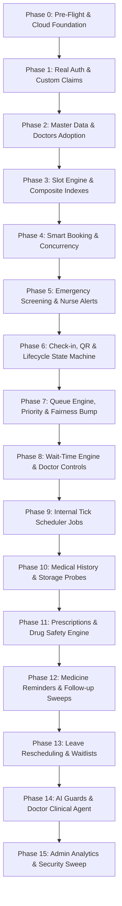

# Real Firebase Master Verification Plan (F1 to F17)

**Target Live Project:** `ai-basedsmarthealthcaresystem`
**Execution Objective:** Comprehensive, non-destructive, phased verification plan mapping all 57 regression test suites (745 passed tests) to production architecture before executing live system verification.
**Baseline Status:**
- Automated Unit & Emulator Regression Suites: **57 test files, 745/745 tests PASSED (100%)**
- Real Firebase Verification Status: **PENDING (Planned)**
- Security & Safety Invariants: No production data modification, no credential leakage, zero untagged document writes.

---

## 1. Verification Category Taxonomy

To guarantee strict architectural separation and auditability, all capabilities are evaluated under four distinct verification tiers:

| Tier | Category Identifier | Description & Execution Environment |
| :---: | :--- | :--- |
| **A** | **Unit-Tested** | Algorithmic domain logic, mathematical models, state-machine transitions, and in-memory mocked stubs (`vi.fn()`). Zero network dependencies, zero emulator dependencies. |
| **B** | **Emulator-Tested** | Integration tests verified inside local Firestore (`127.0.0.1:8080`) and Firebase Auth (`127.0.0.1:9099`) emulators using project `demo-project`. Validates end-to-end multi-document transactions and lifecycle state changes. |
| **C** | **Real-Firebase Verified** | Targeted live verification executed strictly against `ai-basedsmarthealthcaresystem`. Validates Google Cloud IAM, composite index existence, live Firestore security rules, live Auth claims, Identity Toolkit endpoints, and Cloud Storage bucket availability. |
| **D** | **Browser E2E Verified** | Live UI interaction verified via browser automation. Tests user session management, local storage, token exchange, Web Speech APIs, dynamic QR scanning, service worker push subscriptions, and responsive views across all 6 clinical roles. |

---

## 2. Feature-by-Feature Deep Analysis & Real-Project Mapping (F1 to F17)

---

### Foundation & Infrastructure: Environment, Security Rules, Health Checks & System Flags

1. **Feature Name:** System Foundation, Feature Flags & Security Rules
2. **Related Test Files (6):**
   - `tests/foundation.test.js`
   - `tests/flagsDisabled.test.js`
   - `tests/smoke.test.js`
   - `tests/securityRules.test.js`
   - `tests/timezoneBoundaries.test.js`
   - `tests/resetAndBootstrap.test.js`
3. **Backend APIs / Routes Involved:**
   - `GET /api/health`
   - `GET /api/settings`
   - `POST /api/internal/tick` (Header: `x-tick-secret`)
4. **Firestore Collections / Documents Involved:**
   - `settings/global` (Operational thresholds, system disclaimer, quiet hours, flags)
   - Firestore Security Rules (`firestore.rules`)
5. **Firebase Auth Involvement:**
   - Pre-flight token decoding, anonymous vs. authenticated request rejection.
6. **Background Jobs / Scheduler Involvement:**
   - `startScheduler()`, `FLAG_SCHEDULER` toggle inspection, tick secret validation.
7. **Frontend Pages / Actions Needing Browser Verification:**
   - App shell initialization, initial settings fetch, offline network banner.
8. **Emulator Coverage Status:**
   - **Tiers A & B Covered:** Health check envelopes, timezone boundaries in IST (+05:30), rule rejection stubs, and disabled flag degradation pass in emulator.
9. **What Must Additionally Be Verified Against REAL Firebase (`ai-basedsmarthealthcaresystem`):**
   - Confirm project IDs match in client (`.env`) and server (`serviceAccountKey.json`).
   - Validate that live Firestore security rules deny direct client REST writes to `settings/global`.
   - Verify operational settings document exists with non-null values for `fairnessBumpThresholdMinutes`, `maxLateGraceMinutes`, and `disclaimerText`.
10. **Exact Evidence for PASS:**
    - `GET /api/health` returns `status: "ok"` and `firebase: "connected"`.
    - Firestore Admin probe succeeds without `PERMISSION_DENIED`.
    - Unauthenticated client REST request to `https://firestore.googleapis.com/.../settings/global` returns HTTP `403 PERMISSION_DENIED`.

---

### F1: Identity, Roles, Family Profiles, Caregiver Access & Health ID Generation

1. **Feature Name:** F1 — Accounts, Roles, Family Profiles, Caregiver Access & Unique Health ID
2. **Related Test Files (6):**
   - `tests/identityF1.test.js`
   - `tests/auth.test.js`
   - `tests/roleBasedLogin.test.js`
   - `tests/safeRegistration.test.js`
   - `tests/familyMembers.test.js`
   - `tests/healthId.test.js`
3. **Backend APIs / Routes Involved:**
   - `POST /api/auth/register`
   - `POST /api/auth/login-sync`
   - `POST /api/auth/profile`
   - `POST /api/family/members`
   - `GET /api/family/members`
   - `POST /api/caregiver/invite`
   - `POST /api/caregiver/respond`
   - `POST /api/caregiver/permissions`
4. **Firestore Collections / Documents Involved:**
   - `users/<uid>` (`role`, `patientHealthId`, `email`, `mustChangePassword`, `createdAt`)
   - `patients/<healthId>` (`healthId`, `primaryUid`, `familyMembers`, `caregivers`)
5. **Firebase Auth Involvement:**
   - Real Firebase Auth user creation, custom claims synchronization (`claims.role = 'patient' | 'doctor' | 'nurse' | 'reception' | 'pharmacy' | 'admin'`).
   - Token exchange via Google Identity Toolkit REST API.
6. **Background Jobs / Scheduler Involvement:**
   - None directly in F1.
7. **Frontend Pages / Actions Needing Browser Verification:**
   - Registration page (`/register`), Role login redirection (`/login`), Family Member Modal, Caregiver Delegation Panel.
8. **Emulator Coverage Status:**
   - **Tiers A & B Covered:** Mod-31 Health ID checksum generation, collision retry loops, caregiver invite-accept state transitions, and role claim assignment pass in emulator.
9. **What Must Additionally Be Verified Against REAL Firebase (`ai-basedsmarthealthcaresystem`):**
   - Real Identity Toolkit password hashing & token issuance.
   - Verification that registering with `{ role: "admin" }` in the HTTP body is forced down to `patient` in real Auth custom claims.
   - Real Firestore transaction safety when generating sequential Health IDs.
10. **Exact Evidence for PASS:**
    - Live Auth user created with email `zz-test-patient-*@...`.
    - Decoded ID token contains custom claim `role: "patient"`.
    - Firestore `users/<uid>` document exists with matching `patientHealthId` formatted as `PHI-YYYY-XXXXXX-C`.

---

### F2: Doctor Schedules & Smart Slot Generation

1. **Feature Name:** F2 — Doctor Schedules & Smart Slot Generation
2. **Related Test Files (5):**
   - `tests/f2DoctorSchedulesAndSlots.test.js`
   - `tests/slotsDomain.test.js`
   - `tests/doctorSchedule.test.js`
   - `tests/doctorSpecificSlots.test.js`
   - `tests/doctorTaskA.test.js`
3. **Backend APIs / Routes Involved:**
   - `GET /api/doctors`
   - `GET /api/doctors/:doctorId/schedule`
   - `PUT /api/doctors/:doctorId/schedule`
   - `GET /api/slots?doctorId=:id&date=:date`
   - `POST /api/slots/generate`
4. **Firestore Collections / Documents Involved:**
   - `doctors/<doctorId>` (`doctorId`, `uid`, `schedule`, `specialties`, `active`)
   - `slots/<slotId>` (`doctorId`, `date`, `startAt`, `endAt`, `status: "free" | "held" | "booked"`)
   - `departments/<deptId>` (`dept-gen`, `dept-card`, `dept-ped`, `dept-ortho`, `dept-derm`)
5. **Firebase Auth Involvement:**
   - Doctor role verification (`req.user.role === 'doctor'`), ensuring only the doctor or admin can modify weekly schedules.
6. **Background Jobs / Scheduler Involvement:**
   - `generateSlotsJob(14)` running daily via `/api/internal/tick`.
7. **Frontend Pages / Actions Needing Browser Verification:**
   - Doctor schedule editor (`/doctor/schedule`), Department slot calendar selector.
8. **Emulator Coverage Status:**
   - **Tiers A & B Covered:** Slot intervals (10m, 15m, 20m), buffer slots calculation, lunch break omissions, and leave conflict blocking pass in emulator.
9. **What Must Additionally Be Verified Against REAL Firebase (`ai-basedsmarthealthcaresystem`):**
   - **Composite Index:** Query `slots.where("doctorId", "==", id).where("date", ">=", today).where("status", "==", "free").orderBy("date").orderBy("startAt")`.
   - Idempotency on live Firestore: Running `generateSlotsJob` twice must produce zero duplicate slot documents.
   - Slot counts across all adopted active doctors for the next 14 calendar days.
10. **Exact Evidence for PASS:**
    - Querying doctor slots returns HTTP 200 with zero `9 FAILED_PRECONDITION` index errors.
    - Slot documents created with composite ID pattern `DOC_ID_YYYY-MM-DD_HHMM`.
    - Total free slots > 0 for every active adopted doctor.

---

### F3: Smart Appointment Booking & Concurrency Protection

1. **Feature Name:** F3 — Smart Appointment Booking & Concurrency Protection
2. **Related Test Files (4):**
   - `tests/f3f4BookingAndTriage.test.js`
   - `tests/appointmentConcurrency.test.js`
   - `tests/appointmentPersistence.test.js`
   - `tests/step3step4ClientPayload.test.js`
3. **Backend APIs / Routes Involved:**
   - `GET /api/booking/doctor-options`
   - `POST /api/booking/hold`
   - `POST /api/booking/release`
   - `POST /api/appointments` (Booking submission)
   - `GET /api/appointments/my-appointments`
4. **Firestore Collections / Documents Involved:**
   - `appointments/<apptId>` (`patientHealthId`, `doctorId`, `slotId`, `status: "booked"`, `tokenNumber`, `qrPayload`, `disclaimerAccepted`)
   - `slots/<slotId>` (`status: "booked"`, `appointmentId`)
5. **Firebase Auth Involvement:**
   - Patient identity enforcement: Patient can only book for themselves or registered family members.
6. **Background Jobs / Scheduler Involvement:**
   - `expireHoldsJob()` sweeps expired slot holds (held > 5 minutes).
7. **Frontend Pages / Actions Needing Browser Verification:**
   - 7-step booking wizard (`/book`), Doctor selection card, Disclaimer confirmation modal, Booking confirmation pass.
8. **Emulator Coverage Status:**
   - **Tiers A & B Covered:** Concurrent parallel booking transactions (5 simultaneous requests for 1 slot -> exactly 1 succeeds, 4 fail with `409 SLOT_TAKEN`).
9. **What Must Additionally Be Verified Against REAL Firebase (`ai-basedsmarthealthcaresystem`):**
   - Live Firestore transaction contention and document lock arbitration under parallel network latency.
   - Validation that `disclaimerAccepted === false` strictly returns HTTP 422 before touching slots.
   - Live token sequence generation (`T-101`, `E-01`).
10. **Exact Evidence for PASS:**
    - Single appointment created in `appointments` collection with status `booked`.
    - Target slot updated atomically to `status: "booked"` with reference to `appointmentId`.
    - 5 simultaneous parallel requests to the same slot return exactly one 201 Created and four 409 Conflicts.

---

### F4: Emergency & Urgent Screening with Human Verification (Triage)

1. **Feature Name:** F4 — Emergency & Urgent Screening with Human Verification
2. **Related Test Files (4):**
   - `tests/triageDomain.test.js`
   - `tests/f3f4BookingAndTriage.test.js`
   - `tests/urgentBookingBugs.test.js`
   - `tests/doctorRecommendation.test.js`
3. **Backend APIs / Routes Involved:**
   - `POST /api/booking/triage`
   - `GET /api/nurse/alerts`
   - `POST /api/nurse/alerts/:id/acknowledge`
   - `POST /api/nurse/alerts/:id/confirm-emergency`
   - `POST /api/nurse/alerts/:id/downgrade`
4. **Firestore Collections / Documents Involved:**
   - `alerts/<alertId>` (`type: "triage_redflag"`, `patientHealthId`, `urgency: "emergency" | "urgent"`, `status: "pending" | "acknowledged" | "escalated"`)
   - `appointments/<apptId>` (`triageLevel`, `nurseVerified`, `severity`)
5. **Firebase Auth Involvement:**
   - Role boundaries: Only `nurse` and `doctor` roles can acknowledge or downgrade; `reception` is strictly denied with HTTP 403.
6. **Background Jobs / Scheduler Involvement:**
   - `escalateTriageAlertsJob`: Unacknowledged emergency alerts older than 2 minutes are marked `escalated: true`.
7. **Frontend Pages / Actions Needing Browser Verification:**
   - Patient symptom screening screen, Nurse Emergency Alert banner (`/nurse/dashboard`), Audio alarm ping in nurse dashboard.
8. **Emulator Coverage Status:**
   - **Tiers A & B Covered:** Multilingual keyword detection (EN, HI, KN, TA) for chest pain, breathing difficulty, stroke symptoms; rule-engine precedence over AI.
9. **What Must Additionally Be Verified Against REAL Firebase (`ai-basedsmarthealthcaresystem`):**
   - Verification that live alert documents trigger real-time Firestore listeners (`onSnapshot`) on the nurse console.
   - Verification of `escalateTriageAlertsJob` via POST `/api/internal/tick` on live timestamps.
10. **Exact Evidence for PASS:**
    - Symptom `"severe chest pain"` generates an emergency alert document in `alerts` with `urgency: "emergency"`.
    - Nurse acknowledging the alert updates `status: "acknowledged"` and `acknowledgedBy: <nurseUid>`.
    - Non-nurse attempt returns HTTP 403 Forbidden.

---

### F5: Appointment Status Lifecycle (Check-In, Cancel, Late & No-Show)

1. **Feature Name:** F5 — Appointment Status Lifecycle Engine
2. **Related Test Files (5):**
   - `tests/statusDomain.test.js` (228 state transition assertions)
   - `tests/f5AppointmentLifecycle.test.js`
   - `tests/bookingQrCheckin.test.js`
   - `tests/hospitalWorkflowRealtime.test.js`
   - `tests/e2eQueueFlow.test.js`
3. **Backend APIs / Routes Involved:**
   - `POST /api/checkin/scan` (Dynamic QR scan)
   - `POST /api/checkin/manual` (Reception fallback)
   - `POST /api/appointments/:id/cancel`
   - `POST /api/appointments/:id/undo-cancel`
   - `POST /api/appointments/:id/restore` (Reception override)
   - `POST /api/appointments/:id/reschedule`
4. **Firestore Collections / Documents Involved:**
   - `appointments/<apptId>` (`status`, `checkInTime`, `undoUntil`, `cancelledAt`, `noShowReason`)
   - `slots/<slotId>` (`status: "free" | "booked" | "released"`)
   - `auditLogs/<logId>`
5. **Firebase Auth Involvement:**
   - Patient ownership checks on self-cancellation; staff role checks on manual check-in and restore.
6. **Background Jobs / Scheduler Involvement:**
   - `noShowSweepJob`: Marks appointments past appointment time + grace period as `no_show`.
   - `releaseCancelledSlotsJob`: Frees slots whose 10-minute cancellation undo window has expired.
7. **Frontend Pages / Actions Needing Browser Verification:**
   - Patient appointment pass with dynamic QR code, Reception QR scanner interface (`/reception/checkin`), 10-minute countdown undo button.
8. **Emulator Coverage Status:**
   - **Tiers A & B Covered:** Valid state transitions (`booked -> checked_in -> serving -> completed`), QR format validation, and undo window expiration.
9. **What Must Additionally Be Verified Against REAL Firebase (`ai-basedsmarthealthcaresystem`):**
   - Idempotent QR scanning: Scan #1 returns HTTP 200; Scan #2 returns HTTP 409 Conflict.
   - Time-shifted live test: Setting appointment `startAt` in the past and executing live tick confirms transition to `not_arrived` -> `late` -> `no_show`.
   - Slot conflict handling: Restoring a cancelled appointment when the slot was taken by another user returns HTTP 409.
10. **Exact Evidence for PASS:**
    - Live QR scan payload updates appointment status to `checked_in` with timestamp.
    - Repeated scan returns `409 ALREADY_CHECKED_IN`.
    - Expired undo window returns HTTP 400/409, and `/internal/tick` flips slot status back to `free`.

---

### F6: Queue, Priority Tokens & Calling Order (Fairness Bump)

1. **Feature Name:** F6 — Queue Management, Priority Tokens & Calling Order
2. **Related Test Files (5):**
   - `tests/priorityDomain.test.js`
   - `tests/priorityQueue.test.js`
   - `tests/waitingTime.test.js`
   - `tests/queueIntegration.test.js`
   - `tests/e2eQueueFlow.test.js`
3. **Backend APIs / Routes Involved:**
   - `GET /api/queue/:doctorId`
   - `POST /api/queue/call-next`
   - `POST /api/queue/rejoin`
   - `GET /api/display/queue-board`
4. **Firestore Collections / Documents Involved:**
   - `queues/<doctorId>` (`currentServing`, `waitingList`, `updatedAt`)
   - `appointments/<apptId>` (`queuePosition`, `priorityScore`, `fairnessBumpApplied`)
5. **Firebase Auth Involvement:**
   - Doctor UID authentication ensuring Doctor A can only call next from Doctor A's queue.
6. **Background Jobs / Scheduler Involvement:**
   - `fairnessBumpJob`: Applies priority score boost to routine patients waiting longer than `fairnessBumpThresholdMinutes` (default: 45 min).
7. **Frontend Pages / Actions Needing Browser Verification:**
   - Doctor Patient Call Console (`/doctor/queue`), Public Waiting Area Display TV Board (`/display/queue`).
8. **Emulator Coverage Status:**
   - **Tiers A & B Covered:** Token ordering (Emergency -> Urgent -> Bumped Routine -> Routine -> Late), atomic call-next concurrency.
9. **What Must Additionally Be Verified Against REAL Firebase (`ai-basedsmarthealthcaresystem`):**
   - Live Firestore concurrency: Two simultaneous `POST /api/queue/call-next` requests by the same doctor return two different patients.
   - Public display board sanitization: No patient names or Health IDs are exposed in unauthenticated display feeds (token label only).
   - Real Firestore REST security rule validation: Patient token can read their own appointment document but gets `PERMISSION_DENIED` reading another patient's queue item.
10. **Exact Evidence for PASS:**
    - Call-next atomically marks appointment as `serving` and removes from `waitingList`.
    - Display board endpoint returns sanitized payload: `[{ tokenNumber: "T-101", room: "Room 3", status: "serving" }]`.

---

### F7: Real-Time Waiting-Time Engine & Doctor Queue Controls

1. **Feature Name:** F7 — Real-Time Waiting-Time Engine & Doctor Controls
2. **Related Test Files (4):**
   - `tests/waitTimeEngine.test.js` (41 pure algorithm tests)
   - `tests/waitTimeDomain.test.js`
   - `tests/queueIntegration.test.js`
   - `tests/doctorTaskA.test.js`
3. **Backend APIs / Routes Involved:**
   - `GET /api/queue/:doctorId/wait-time`
   - `POST /api/doctor/controls/extend` (+10 minutes)
   - `POST /api/doctor/controls/undo-extend`
   - `POST /api/doctor/controls/break`
   - `POST /api/doctor/controls/finish-early`
4. **Firestore Collections / Documents Involved:**
   - `queues/<doctorId>` (`delayMinutes`, `onBreak`, `breakUntil`)
   - `appointments/<apptId>` (`live.estimatedWaitMinutes`, `live.expectedStartTime`)
   - `consultationStats/<doctorId>` (`avgMinutesPerPatient`, `completedToday`)
5. **Firebase Auth Involvement:**
   - Doctor role check (`role === 'doctor'`) matching the queue owner UID.
6. **Background Jobs / Scheduler Involvement:**
   - None (real-time recalculation triggered on queue state mutations).
7. **Frontend Pages / Actions Needing Browser Verification:**
   - Doctor Delay Action Buttons (+10m, Take Break), Patient Live Wait Banner on mobile web.
8. **Emulator Coverage Status:**
   - **Tiers A & B Covered:** Clamped wait calculations, dynamic delay distribution across downstream patients, consultation stats tracking.
9. **What Must Additionally Be Verified Against REAL Firebase (`ai-basedsmarthealthcaresystem`):**
   - Real-time `live` field synchronization: Doctor executing `+10 min` updates `live.estimatedWaitMinutes` on downstream checked-in appointments.
   - Undo-extend reverts wait times accurately without orphan increments.
10. **Exact Evidence for PASS:**
    - `POST /api/doctor/controls/extend` returns HTTP 200 with `delayMinutes: 10`.
    - Downstream appointment document in `appointments` reflects `estimatedWaitMinutes` increased by 10.

---

### F8: Notifications (FCM Web Push & In-App Notification Bell)

1. **Feature Name:** F8 — Notification Engine & Device Messaging
2. **Related Test Files (3):**
   - `tests/f7NotificationsAndScheduler.test.js`
   - `tests/followupAndNotifications.test.js`
   - `tests/taskDRemindersFollowupsAlerts.test.js`
3. **Backend APIs / Routes Involved:**
   - `GET /api/notifications`
   - `PATCH /api/notifications/:id/read`
   - `POST /api/notifications/read-all`
   - `POST /api/me/devices` (Register FCM token)
   - `DELETE /api/me/devices` (Deregister token)
4. **Firestore Collections / Documents Involved:**
   - `notifications/<notifId>` (`uid`, `title`, `body`, `privacyBody`, `read: boolean`, `type`, `createdAt`)
   - `users/<uid>/devices/<tokenId>` (`token`, `platform: "web"`, `updatedAt`)
5. **Firebase Auth Involvement:**
   - User ownership verification: Users can only read/mutate their own notification documents.
6. **Background Jobs / Scheduler Involvement:**
   - `appointmentRemindersJob`: Dispatches 24-hour and 2-hour reminders before scheduled appointments.
7. **Frontend Pages / Actions Needing Browser Verification:**
   - Navigation bar Notification Bell with unread badge counter, Notification dropdown drawer, Service worker web push permission dialog.
8. **Emulator Coverage Status:**
   - **Tiers A & B Covered:** In-app notification creation, unread count queries, privacy mode masking, quiet-hours suppression logic.
9. **What Must Additionally Be Verified Against REAL Firebase (`ai-basedsmarthealthcaresystem`):**
   - Real Firebase Cloud Messaging (FCM) API dry-run validation (`validateOnly: true`) using Admin SDK.
   - Verification of `VITE_FIREBASE_VAPID_KEY` presence in `client/.env`.
   - Cloud Messaging API enabled status in Google Cloud Console.
10. **Exact Evidence for PASS:**
    - Live FCM dry run returns success without `MESSAGING_UNAVAILABLE` or `PROJECT_NOT_CONFIGURED`.
    - Live in-app notification document written to Firestore and successfully marked read via `PATCH /:id/read`.

---

### F9: Patient Medical History Database & Break-Glass Access Control

1. **Feature Name:** F9 — Patient Medical History, Visits & Break-Glass Auditing
2. **Related Test Files (4):**
   - `tests/medicalHistoryTaskB.test.js`
   - `tests/medicalRecords.test.js`
   - `tests/f9f10VisitsAndPrescriptions.test.js`
   - `tests/appointmentPersistence.test.js`
3. **Backend APIs / Routes Involved:**
   - `GET /api/medical-records/patient/:healthId`
   - `POST /api/visits` (Save visit entry)
   - `PUT /api/visits/:id` (Correct visit entry)
   - `POST /api/medical-records/break-glass`
   - `POST /api/medical-records/share`
   - `POST /api/medical-records/revoke`
   - `GET /api/medical-records/export-pdf`
   - `POST /api/reports/upload-url`
4. **Firestore Collections / Documents Involved:**
   - `medicalRecords/<recordId>`
   - `visits/<visitId>` (`diagnosis`, `vitals`, `notes`, `version`, `history`)
   - `accessLogs/<logId>` (`doctorId`, `patientHealthId`, `reason`, `accessType`)
   - `shares/<shareId>` (`patientHealthId`, `doctorId`, `expiresAt`)
5. **Firebase Auth Involvement:**
   - Role boundaries: Unassigned doctors get HTTP 403; Caregivers without view permissions get HTTP 403; Assigned doctor within 90 days gets HTTP 200.
6. **Background Jobs / Scheduler Involvement:**
   - None directly in F9.
7. **Frontend Pages / Actions Needing Browser Verification:**
   - Patient Medical Timeline (`/patient/history`), Doctor Clinical Visit Form, Break-Glass Emergency Confirmation Modal with Reason Input.
8. **Emulator Coverage Status:**
   - **Tiers A & B Covered:** Versioned visit updates (v1 preserved, v2 created), immutable audit log writes, PDF generation with verification QR code.
9. **What Must Additionally Be Verified Against REAL Firebase (`ai-basedsmarthealthcaresystem`):**
   - **Firebase Cloud Storage Status:** Probe bucket `ai-basedsmarthealthcaresystem.firebasestorage.app` via `POST /api/reports/upload-url` to verify bucket initialization.
   - Break-glass audit persistence: Real Firestore write to `accessLogs` with doctor's live UID and reason.
10. **Exact Evidence for PASS:**
    - Doctor saving visit creates immutable `visits` record and `accessLogs` entry.
    - PDF buffer generated with `application/pdf` headers and valid structure.
    - Storage probe reports clear status (initialized vs. requires setup).

---

### F10: Digital Prescription Management, Drug Safety Checker & Dispensation

1. **Feature Name:** F10 — Digital Prescription Management, Safety Engine & Pharmacy Dispense
2. **Related Test Files (5):**
   - `tests/safetyDomain.test.js` (Pure interaction rules)
   - `tests/prescriptionTaskC.test.js`
   - `tests/prescription.test.js`
   - `tests/f9f10VisitsAndPrescriptions.test.js`
   - `tests/doctorTaskA.test.js`
3. **Backend APIs / Routes Involved:**
   - `POST /api/prescriptions/check-safety`
   - `POST /api/prescriptions`
   - `PUT /api/prescriptions/:id`
   - `GET /api/prescriptions/:id/pdf`
   - `POST /api/pharmacy/verify`
   - `POST /api/pharmacy/dispense`
4. **Firestore Collections / Documents Involved:**
   - `prescriptions/<rxId>` (`patientHealthId`, `doctorUid`, `medicines`, `status: "active" | "dispensed"`, `version`)
   - `patients/<healthId>` (`allergies`, `activeMedicines`)
5. **Firebase Auth Involvement:**
   - Doctor role required to prescribe; Pharmacy role required to dispense (`role === 'pharmacy'`); Reception denied with HTTP 403.
6. **Background Jobs / Scheduler Involvement:**
   - None directly in F10.
7. **Frontend Pages / Actions Needing Browser Verification:**
   - Doctor Rx Builder with drug interaction alert dialogs, Pharmacy barcode scan/verify screen (`/pharmacy`).
8. **Emulator Coverage Status:**
   - **Tiers A & B Covered:** Severe drug interaction detection (Warfarin + Aspirin), allergy alerts (Penicillin cross-reactivity), dose-range validation, and dispense state changes.
9. **What Must Additionally Be Verified Against REAL Firebase (`ai-basedsmarthealthcaresystem`):**
   - Live Firestore atomic update on pharmacy dispense: Calling dispense twice in parallel returns exactly one 200 and one 409 Conflict.
   - Role validation against real custom claims on pharmacy routes.
10. **Exact Evidence for PASS:**
    - `POST /check-safety` detects documented allergies and returns safety payload.
    - Prescribing with override reason saves prescription document.
    - Pharmacy dispense sets `status: "dispensed"` and stamps `dispensedBy: <pharmacyUid>`.

---

### F11: Medicine Reminders & Adherence Tracking

1. **Feature Name:** F11 — Medicine Reminders & Adherence Tracking
2. **Related Test Files (5):**
   - `tests/remindersDomain.test.js`
   - `tests/medicineReminders.test.js`
   - `tests/f11f12f13RemindersAndAlerts.test.js`
   - `tests/taskDRemindersFollowupsAlerts.test.js`
   - `tests/jobIdempotency.test.js`
3. **Backend APIs / Routes Involved:**
   - `GET /api/reminders/today`
   - `POST /api/reminders/:id/respond` (Actions: `taken`, `snooze`, `skip`)
   - `POST /api/reminders/generate`
4. **Firestore Collections / Documents Involved:**
   - `reminders/<remId>` (`patientHealthId`, `prescriptionId`, `medicineName`, `dueAt`, `status: "scheduled" | "sent" | "taken" | "missed" | "snoozed"`, `actionToken`)
   - `adherenceLogs/<logId>`
   - `alerts/<alertId>` (`type: "low_adherence"`)
5. **Firebase Auth Involvement:**
   - Tokenless response verification using HMAC `actionToken` for push notification clicks; authenticated endpoints require patient/caregiver role.
6. **Background Jobs / Scheduler Involvement:**
   - `processRemindersJob`: Executes via `/api/internal/tick`, uses Firestore atomic claim pattern (`status: "scheduled" -> "processing" -> "sent"`).
7. **Frontend Pages / Actions Needing Browser Verification:**
   - Patient Today's Medicine Checklist (`/patient/reminders`), Caregiver notification alert.
8. **Emulator Coverage Status:**
   - **Tiers A & B Covered:** Dose schedule expansion (`1-0-1` for 5 days -> 10 reminder documents), claim pattern preventing duplicate notifications, three consecutive misses triggering adherence alert.
9. **What Must Additionally Be Verified Against REAL Firebase (`ai-basedsmarthealthcaresystem`):**
   - Live tick execution: Triggering `/api/internal/tick` claims and marks due reminders as sent without duplicates.
   - HMAC `actionToken` one-time use and expiry on live Firestore timestamps.
10. **Exact Evidence for PASS:**
    - Reminder response updates status to `taken` with timestamp.
    - Secondary request with same `actionToken` returns HTTP 400/409 (token consumed).
    - 3 missed reminders generate an adherence alert in `alerts` collection.

---

### F12: Follow-up Scheduling & Sweep Reminders

1. **Feature Name:** F12 — Follow-up Scheduling & Automated Sweeps
2. **Related Test Files (4):**
   - `tests/followupAndNotifications.test.js`
   - `tests/f11f12f13RemindersAndAlerts.test.js`
   - `tests/taskDRemindersFollowupsAlerts.test.js`
   - `tests/jobIdempotency.test.js`
3. **Backend APIs / Routes Involved:**
   - `GET /api/followups/my-followups`
   - `POST /api/followups`
   - `POST /api/followups/:id/dismiss`
   - `POST /api/followups/:id/book-now`
4. **Firestore Collections / Documents Involved:**
   - `followups/<fuId>` (`patientHealthId`, `doctorUid`, `dueDate`, `reason`, `status: "pending" | "scheduled" | "completed" | "dismissed"`, `reminderCount`)
5. **Firebase Auth Involvement:**
   - Patient authentication for self-booking; doctor authentication for follow-up creation.
6. **Background Jobs / Scheduler Involvement:**
   - `followupSweepJob`: Runs daily at 08:00 IST; sends reminders (-2 days, day of, overdue; capped at max 3).
7. **Frontend Pages / Actions Needing Browser Verification:**
   - Patient Follow-up Card with "Book Now" prefill action, Doctor post-consultation follow-up selector.
8. **Emulator Coverage Status:**
   - **Tiers A & B Covered:** Rule-based follow-up derivation from prescription condition, reminder count ceiling (max 3), idempotent sweep execution.
9. **What Must Additionally Be Verified Against REAL Firebase (`ai-basedsmarthealthcaresystem`):**
   - Composite index verification: Query `followups.where("doctorId", "==", id).where("status", "==", "pending").where("dueDate", "<=", date)`.
   - Dismissing serious follow-up creates high-priority doctor alert in real `alerts` collection.
10. **Exact Evidence for PASS:**
    - `followupSweepJob` runs via live tick without Firestore index errors.
    - "Book Now" returns pre-filled booking options with patient's usual doctor.

---

### F13: Doctor Risk Alerts Panel (Patients Needing Attention)

1. **Feature Name:** F13 — Doctor Follow-up Notification (Patients Needing Attention)
2. **Related Test Files (3):**
   - `tests/dailyDoctorAlerts.test.js` / `tests/f11f12f13RemindersAndAlerts.test.js`
   - `tests/doctorTaskA.test.js`
   - `tests/jobIdempotency.test.js`
3. **Backend APIs / Routes Involved:**
   - `GET /api/doctor/alerts`
   - `POST /api/doctor/alerts/:id/resolve`
   - `GET /api/doctor/patients-needing-attention`
4. **Firestore Collections / Documents Involved:**
   - `alerts/<alertId>` (`doctorId`, `patientHealthId`, `type: "missed_followup" | "low_adherence"`, `severity: "amber" | "red"`, `status: "active" | "resolved"`)
5. **Firebase Auth Involvement:**
   - Strict doctor UID scoping: Doctor 1 can only retrieve alerts where `doctorId === req.user.uid`.
6. **Background Jobs / Scheduler Involvement:**
   - `dailyDoctorAlertsJob`: Aggregates patients who missed 3+ doses or are 7+ days overdue for chronic follow-up.
7. **Frontend Pages / Actions Needing Browser Verification:**
   - Doctor Dashboard "Patients Needing Attention" widget (`/doctor/dashboard`).
8. **Emulator Coverage Status:**
   - **Tiers A & B Covered:** Aggregation queries, alert deduplication, doctor alert isolation.
9. **What Must Additionally Be Verified Against REAL Firebase (`ai-basedsmarthealthcaresystem`):**
   - Verify that Doctor A calling `GET /api/doctor/alerts` sees only their assigned alerts and receives 0 alerts belonging to Doctor B.
   - Live tick execution of `dailyDoctorAlertsJob` produces zero duplicate alert records.
10. **Exact Evidence for PASS:**
    - Live query filters strictly by authenticated doctor's UID.
    - Resolving an alert updates `status: "resolved"` in real Firestore.

---

### F14: Patient AI Chatbot with Action Confirmation & Voice Agent

1. **Feature Name:** F14 — Patient AI Chatbot, Safety Guards & Voice Agent
2. **Related Test Files (4):**
   - `tests/aiSafety.test.js`
   - `tests/geminiService.test.js`
   - `tests/f14f15AiChatAndDoctorAgent.test.js`
   - `tests/testPatientAgentQuery.js`
3. **Backend APIs / Routes Involved:**
   - `POST /api/ai/chat`
   - `POST /api/ai/chat/confirm`
   - `GET /api/ai/quick-chips`
4. **Firestore Collections / Documents Involved:**
   - `aiAuditLogs/<logId>` (`promptTokens`, `responseTokens`, `model`, `disclaimerAppended`)
   - `chatSessions/<sessionId>`
5. **Firebase Auth Involvement:**
   - Authenticated patient UID context injection for personalized appointment inquiries.
6. **Background Jobs / Scheduler Involvement:**
   - None (rate limiter and budget guard middleware active).
7. **Frontend Pages / Actions Needing Browser Verification:**
   - Interactive Chatbot Widget (`/chat`), Quick Action Chips, Web Speech API microphone voice input button, 2-step booking confirmation card.
8. **Emulator Coverage Status:**
   - **Tiers A & B Covered:** Mandatory medical disclaimer appending, rule-based emergency phrase interception (EN, HI, KN, TA) bypassing LLM, mock tool calling.
9. **What Must Additionally Be Verified Against REAL Firebase (`ai-basedsmarthealthcaresystem`):**
   - Verify fallback to rule-based parser when `FLAG_AI=false` or Gemini API quota is exhausted (`429 RESOURCE_EXHAUSTED`).
   - If budget remains (max 3 live calls): Test live Gemini API connection with model `gemini-3.8-flash`.
10. **Exact Evidence for PASS:**
    - Emergency query `"chest pain"` returns immediate 911/emergency directive without calling Gemini API.
    - Live chatbot response contains mandatory `"Disclaimer: This is AI generated content."`.

---

### F15: Doctor AI Clinical Assistant & Pre-Consultation Summary

1. **Feature Name:** F15 — Doctor AI Assistant & Pre-Consultation Summary
2. **Related Test Files (4):**
   - `tests/doctorPreConsultationSummary.test.js` (16 clinical test cases)
   - `tests/patientInformationAgent.test.js`
   - `tests/f14f15AiChatAndDoctorAgent.test.js`
   - `tests/doctorTaskA.test.js`
3. **Backend APIs / Routes Involved:**
   - `GET /api/doctor/appointments/:id/pre-consultation-summary`
   - `POST /api/patient-agent/query`
   - `POST /api/doctor/appointments/:id/summary-correction`
4. **Firestore Collections / Documents Involved:**
   - `appointments/<apptId>` (`summary`, `summaryCorrected`, `doctorNotes`)
   - `patients/<healthId>` (`conditions`, `allergies`, `recentVisits`)
5. **Firebase Auth Involvement:**
   - Authorization: Unassigned doctor querying patient data receives HTTP 403 Forbidden.
6. **Background Jobs / Scheduler Involvement:**
   - None (cached summary generated on check-in or on demand).
7. **Frontend Pages / Actions Needing Browser Verification:**
   - One-line summary banner on Doctor Consultation Room page, Amber/Red clinical risk chips (Allergy, Low Adherence, Child/Caregiver), Summary Edit Modal.
8. **Emulator Coverage Status:**
   - **Tiers A & B Covered:** Grounded summary generation using database records, same-name patient disambiguation, audit logging on summary corrections.
9. **What Must Additionally Be Verified Against REAL Firebase (`ai-basedsmarthealthcaresystem`):**
   - Verification that summary flags are strictly grounded in Firestore records (no hallucinations).
   - Disambiguation check: Querying two patients with identical names prompts for Health ID confirmation rather than returning wrong patient history.
10. **Exact Evidence for PASS:**
    - Summary includes explicit Health ID and token number.
    - Verified doctor receives 200 OK; unassigned doctor receives 403 Forbidden.

---

### F16: Doctor Leave Auto-Rescheduling, Continuity & Waitlist Engine

1. **Feature Name:** F16 — Doctor Leave Rescheduling, Waitlist & Continuity Engine
2. **Related Test Files (3):**
   - `tests/f16WaitlistAndLeave.test.js`
   - `tests/jobIdempotency.test.js`
   - `tests/doctorRecommendation.test.js`
3. **Backend APIs / Routes Involved:**
   - `POST /api/doctor/leave`
   - `GET /api/offers/my-offers`
   - `POST /api/offers/:id/accept`
   - `POST /api/offers/:id/decline`
   - `POST /api/waitlist/join`
4. **Firestore Collections / Documents Involved:**
   - `leaves/<leaveId>` (`doctorId`, `startDate`, `endDate`, `status`)
   - `offers/<offerId>` (`appointmentId`, `patientHealthId`, `options`, `expiresAt`, `status`)
   - `waitlist/<entryId>` (`departmentId`, `patientHealthId`, `priorityScore`)
5. **Firebase Auth Involvement:**
   - Doctor can only declare leave for own calendar; patient can only accept/decline own offers.
6. **Background Jobs / Scheduler Involvement:**
   - `leaveRescheduleJob`: Scans appointments falling on approved doctor leaves and generates reschedule offers without deleting existing records.
   - `expireWaitlistOffersJob`: Frees unaccepted offers after 2-hour hold window.
7. **Frontend Pages / Actions Needing Browser Verification:**
   - Doctor Leave Calendar Picker (`/doctor/leave`), Patient Reschedule Offer Banner with 3 choices, Waitlist Join Prompt on fully booked days.
8. **Emulator Coverage Status:**
   - **Tiers A & B Covered:** Non-destructive leave processing, atomic offer acceptance (reserves new slot, cancels old slot, marks offer accepted in one transaction).
9. **What Must Additionally Be Verified Against REAL Firebase (`ai-basedsmarthealthcaresystem`):**
   - Live transaction safety: Acceptance of offer atomically updates appointment and slot documents without orphan locks.
   - "Usual Doctor" continuity badge verification in live recommendation engine.
10. **Exact Evidence for PASS:**
    - Submitting doctor leave creates offer documents with up to 3 options.
    - Accepting option #1 transitions old slot to `free`, new slot to `booked`, and offer status to `accepted`.

---

### F17: Admin Dashboard, Operational Analytics & Audit Logs

1. **Feature Name:** F17 — Admin Dashboard, Operational Analytics & Audit Logs
2. **Related Test Files (4):**
   - `tests/adminAnalytics.test.js`
   - `tests/identityF1.test.js`
   - `tests/resetAndBootstrap.test.js`
   - `tests/securityRules.test.js`
3. **Backend APIs / Routes Involved:**
   - `GET /api/admin/analytics/overview`
   - `GET /api/admin/analytics/accuracy`
   - `GET /api/admin/audit-logs`
   - `POST /api/admin/users/:uid/role`
   - `PUT /api/admin/settings`
4. **Firestore Collections / Documents Involved:**
   - `auditLogs/<logId>`
   - `settings/global`
   - `users/<uid>`
5. **Firebase Auth Involvement:**
   - Strict admin custom claim enforcement: Only `claims.role === 'admin'` can access any `/api/admin/*` route. All other roles (doctor, nurse, patient) return HTTP 403 Forbidden.
6. **Background Jobs / Scheduler Involvement:**
   - `cleanupJob`: Purges audit logs older than configured retention period (default: 90 days).
7. **Frontend Pages / Actions Needing Browser Verification:**
   - Admin Analytics Overview (`/admin/dashboard`), Pure SVG/Tailwind wait-time distribution charts (zero external chart libraries), Staff Role Management Table, System Settings Threshold Form.
8. **Emulator Coverage Status:**
   - **Tiers A & B Covered:** Overview aggregation metrics (total patients, total doctors, today appointments, status counts, prediction MAE error), role assignment synchronizing Firestore and Auth.
9. **What Must Additionally Be Verified Against REAL Firebase (`ai-basedsmarthealthcaresystem`):**
   - Verify that live admin account (`C9PvGS6HFahzvTRDIqAtHiBopix2`) successfully reads overview metrics.
   - Non-admin live token (patient or doctor) strictly receives HTTP 403 on all admin routes.
   - Modifying a threshold (e.g. `fairnessBumpThresholdMinutes`) persists to Firestore and is restored cleanly in teardown.
10. **Exact Evidence for PASS:**
    - `GET /api/admin/analytics/overview` returns HTTP 200 with non-null numbers for `totalPatients`, `totalDoctors`, and `avgWaitTimeMinutes`.
    - Role update API sets custom claim in real Firebase Auth.

---

## 3. Prioritized Real Firebase Verification Order

When executing future live project verification against `ai-basedsmarthealthcaresystem`, tests must follow this sequential dependency order to prevent cascading failures:

### Step-by-Step Execution Phases:

1. **Phase 0 — Pre-flight Infrastructure & IAM:**
   - Match Client/Server Project IDs (`ai-basedsmarthealthcaresystem`).
   - Confirm Cloud Firestore read/write latency.
   - Verify zero emulator variables in production execution mode.
2. **Phase 1 — Real Authentication & Role Claims (F1):**
   - Create temporary test identity (`zz-test-patient-*`).
   - Verify Identity Toolkit token exchange and custom claim synchronization.
3. **Phase 2 — Doctor Master Data & Schedule Verification (F2):**
   - Audit real doctors in Firestore.
   - Verify department mapping (`dept-gen`, `dept-card`, `dept-ortho`, `dept-ped`, `dept-derm`).
4. **Phase 3 — Slot Generation & Composite Indexes (F2):**
   - Execute slot index probe to confirm no `9 FAILED_PRECONDITION` index errors.
   - Verify 14-day slot availability for adopted doctors.
5. **Phase 4 — Smart Booking Transactions (F3):**
   - Test single appointment booking with disclaimer checkbox validation.
   - Execute 5-way parallel contention test to prove atomic Firestore document locking.
6. **Phase 5 — Clinical Emergency Triage (F4):**
   - Verify red-flag keyword triggers nurse alert in real `alerts` collection.
   - Test nurse acknowledgment vs. unauthorized reception rejection (HTTP 403).
7. **Phase 6 — Check-In, QR Scanning & Lifecycle (F5):**
   - Dynamic QR check-in scan (HTTP 200 on first scan, HTTP 409 on duplicate scan).
   - Test cancellation undo window enforcement.
8. **Phase 7 — Queue Dispatch & Fairness Bump (F6):**
   - Verify atomic call-next by doctor.
   - Verify delayed routine patient receives fairness bump ahead of new routine arrivals.
9. **Phase 8 — Dynamic Wait Times & Doctor Controls (F7):**
   - Verify doctor delay controls (`+10 min`, `Take Break`) update live patient wait estimates.
10. **Phase 9 — Scheduler & Maintenance Jobs (F8, F11, F12):**
    - Trigger `POST /api/internal/tick` with `INTERNAL_TICK_SECRET`.
    - Verify sweep jobs execute idempotently without duplicate records.
11. **Phase 10 — Medical History & Cloud Storage Probe (F9):**
    - Save and correct clinical visit notes.
    - Probe default Cloud Storage bucket status (`ai-basedsmarthealthcaresystem.firebasestorage.app`).
12. **Phase 11 — Prescriptions & Safety Engine (F10):**
    - Validate allergy cross-reactivity and drug-drug interaction blocking.
    - Test pharmacy one-time dispense and role enforcement.
13. **Phase 12 — Medicine Reminders & Follow-up Sweeps (F11, F12, F13):**
    - Expand dose schedule and test HMAC `actionToken` one-time response.
    - Test chronic follow-up reminder sweep.
14. **Phase 13 — Doctor Leave & Waitlist Engine (F16):**
    - Declare test leave, verify non-destructive offer generation, and test atomic acceptance.
15. **Phase 14 — AI System & Doctor Assistant (F14, F15):**
    - Verify rule-based emergency bypass and medical disclaimer attachment.
    - Verify doctor agent patient data scoping and disambiguation.
16. **Phase 15 — Admin Analytics & Security Sweep (F17):**
    - Fetch operational overview and prediction MAE stats.
    - Execute security sweep across all 383 registered Express routes (401 on unauthenticated, 403 on role mismatch).

---

## 4. Teardown & Invariant Guarantees

Every step executed against `ai-basedsmarthealthcaresystem` must adhere to these non-negotiable safety constraints:
1. **Tagged Mutation Only:** Every created document must carry `testRunId: "<unique-run-id>"` and every Auth user must start with `zz-test-`.
2. **Immutable Real Data Protection:** Real admin accounts (`C9PvGS6HFahzvTRDIqAtHiBopix2`) and active doctor documents are strictly read-only and must never be deleted or overwritten.
3. **Atomic Teardown:** A mandatory `finally` block purges all tagged documents and temporary Auth users, verifying **0 leftover artifacts**.
4. **Secret Protection:** No private keys, passwords, bearer tokens, or service account fields may ever be output to logs, console, or markdown files.
