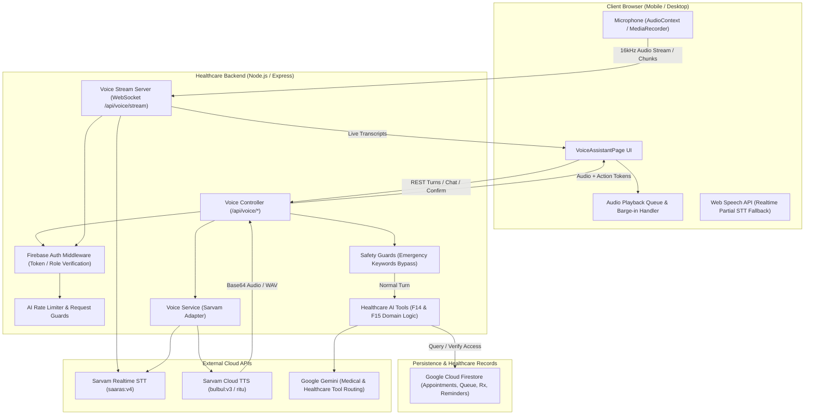

# Cloud-Based Multilingual Healthcare Voice Assistant Architecture

## 1. Overview & System Purpose

The **SmartCare Voice Assistant** (`Arogya`) is a production-grade, browser-based multilingual voice agent designed for healthcare patients. It runs seamlessly on modern browsers (Android, iOS, Windows, macOS, Linux) without requiring patients to download or install local models, Python, Whisper, or desktop software.

All artificial intelligence and speech computation is executed via cloud APIs and the existing Node.js + Express backend, anchored by Firebase Authentication and Firestore data security rules.

---

## 2. Architectural Diagram

---

## 3. Core Architectural Principles

### 3.1 Zero-Install Patient Experience
- Patients access the assistant by visiting the healthcare web portal on any mobile or desktop browser.
- Microphone access is requested only when the patient explicitly taps the microphone or "Start Conversation" button.
- Initial interaction unlocks browser audio context and autoplay policies cleanly.

### 3.2 Secure Backend Credential Proxying
- Provider API keys (`SARVAM_API_KEY`, `GEMINI_API_KEY`, Firebase Service Account keys) are **strictly confined to the backend server**.
- Neither client bundle artifacts nor browser network requests ever expose third-party cloud credentials.
- All requests are authorized using Firebase JWT tokens or session credentials.

### 3.3 Two-Phase Healthcare Action Confirmation
- Destructive or data-mutating patient actions (such as booking or cancelling appointments) **never commit directly from an LLM call**.
- The assistant constructs a signed, 10-minute expiring `confirmToken` with the structured action parameters.
- The user is presented with a clear action summary card and can confirm via voice ("Yes, confirm") or button tap.
- Execution passes through the authenticated standard application controllers (`bookingController`, `appointmentController`).

### 3.4 Multilingual Support
The assistant supports five major Indian languages:
1. **English (India):** `en-IN`
2. **Kannada:** `kn-IN`
3. **Hindi:** `hi-IN`
4. **Telugu:** `te-IN`
5. **Tamil:** `ta-IN`

Automatic language detection is executed by `saaras:v4` during speech transcription.

### 3.5 Realtime Voice Engineering & Barge-In
- **Interruption (Barge-In):** When a patient starts speaking while the assistant is speaking, the client immediately pauses audio playback, flushes playback queues, and notifies the backend to halt generation.
- **Hands-Free Auto-Turn:** When enabled, the assistant resumes listening automatically 400ms after the spoken reply completes.
- **Audio Sanitization:** Text strings from AI responses are scrubbed of markdown asterisks, blockquotes, URLs, and emojis before delivery to Sarvam TTS, guaranteeing smooth, human-like cadence.

---

## 4. Healthcare Capabilities & Mapped Tools

| Capability | Backend Tool | Authorization / Data Flow |
|---|---|---|
| **Token Status** | `get_token_status` | Resolves patient's active appointment today, token label, and real wait time |
| **Wait Time** | `get_wait_time` | Calculates live queue length, doctor turn duration, and dynamic fairness status |
| **Doctor Timings** | `get_doctor_timings` | Retrieves verified OPD schedules and lunch break intervals |
| **Slot Search** | `find_slots` | Queries available booking slots for doctor or department |
| **Prepare Booking** | `prepare_booking` | Returns structured summary + `confirmToken` (No mutation) |
| **Execute Booking** | `createAppointment` | Triggered only upon verified user confirmation |
| **Prepare Cancel** | `prepare_cancel` | Returns cancellation summary + `confirmToken` |
| **Execute Cancel** | `cancelAppointment` | Validates ownership and applies 10-minute undo window |
| **Prescriptions** | `get_latest_prescription` | Reads latest verified digital prescription and medication frequency |
| **Medicine Reminders**| `get_medicine_reminders` | Fetches active scheduled medication doses |
| **Dose Confirmation** | `mark_dose_taken` | Marks scheduled dose as taken |
| **Upcoming Follow-ups**| `get_upcoming_followups` | Lists scheduled review appointments and target dates |
| **Hospital Info** | `get_hospital_info` | Returns operating departments, OPD hours, and emergency desk contact |
| **Emergency Bypass** | Rule-Based Pre-check | Intercepts chest pain, breathing difficulty, severe bleeding, and dials 108/112 |
